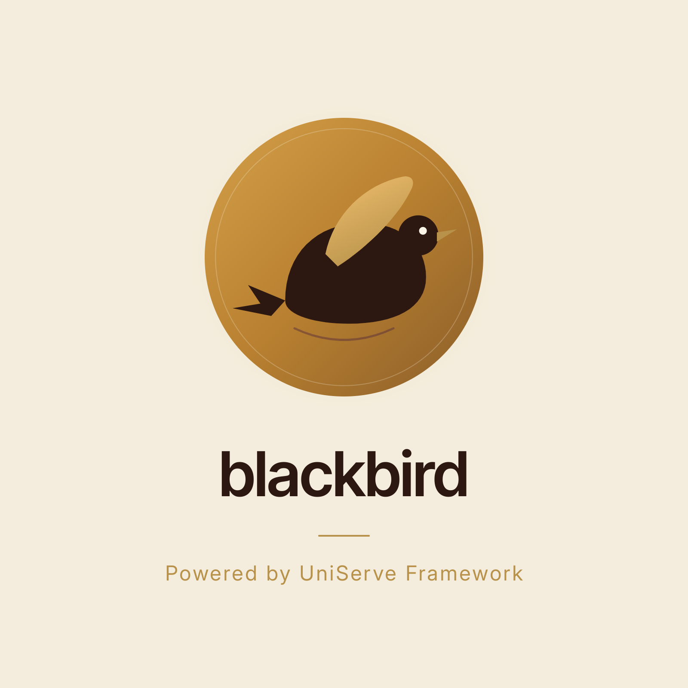

# blackbird
# micro_servers

<p align="center">
  
</p>

一套 DIY 的轻量级微服务架构（UniServe Framework），由 C++、Python、Go 与仓颉(Cangjie) 混合实现。
`core` 作为进程托管服务负责拉起并守护各业务子进程，`redirect80` 将 80 端口流量重定向到 443，`waf` 作为前置 WAF 网关终止 TLS 并做规则匹配，`ca` 作为中央认证服务统一鉴权（waf → ca → gateway 前置拓扑），`gateway` 退化为纯转发反向代理，`db` 提供通用数据库访问与集中式日志收集，`confs` 提供统一配置分发，`ai_review` 提供 AI 内容审核，`static` 与 `dnfs` 作为业务服务对外提供能力。`db2` / `dnfs2` 分别为 `db` / `dnfs` 的 C++20 重实现，接口完全兼容可平替。此外包含 aibox 的终端前端 `BotOps`、独立的机器人硬件控制模块 `bot4cj`、嵌入式帧缓冲图形界面 `lci` 和嵌入式脚本引擎 `libtry`。

## 架构总览

```
                         ┌──────────────────────────────────────────────┐
                         │              core (PMC / Nidus)              │
                         │   进程托管服务 · 监听 :5200 (HTTP 管理接口)    │
                         │   读取 services.yaml 拉起并守护下列子进程      │
                         │   内嵌 confs :8010 (仅 gateway.ini 分发)      │
                         └───────────────┬──────────────────────────────┘
                                         │ 启动 / 守护
          ┌──────────────────┬───────────┼───────────┬──────────────────┬──────────────┐
          ▼                  ▼           ▼           ▼                  ▼              ▼
 ┌──────────────┐  ┌──────────────┐  ┌────────┐  ┌──────────────┐  ┌──────────────┐  ┌──────────────┐
 │     waf      │  │     ca       │  │  fsys  │  │    dnfs2     │  │     db2      │  │  ai_review   │
 │  WAF 网关    │  │ 中央认证     │  │前端托管│  │  树状菜单    │  │ 通用数据库   │  │ AI内容审核   │
 │ :443 (入口)  │  │ :8443 (内部) │  │ :9200  │  │    :8006     │  │    :8005     │  │    :8007     │
 │ coraza+反代  │  │ 认证+前置转发│  │静态/媒体│  │  节点CRUD    │  │ pymsg/TCP    │  │ DeepSeek+RAG │
 └──────┬───────┘  └──────┬───────┘  └───┬────┘  └──────┬───────┘  └──────▲───────┘  └──────▲───────┘
        │ HTTPS终止         │ 认证+转发   │ 代理笔记请求   │ pymsg           │ pymsg           │ HTTP
        ▲                   └─────────────►│             ├─────────────►│─────────────────┘                 │
        │                     ┌───────────►│             │              └─────── HTTP /review ──────────────┘
        │                     │ gateway    │             │
        │                     │ :8445 纯转发│             │
        │                     └────────────►│             │
        │
  ┌─────┴──────┐
  │ redirect80 │  :80 → :443（GET/HEAD 301 / 其余 308，重定向到 waf）
  └────────────┘
 日志链路: waf / ca / gateway / fsys / dnfs2 / ai_review / captcha2 / smtp / aibox / redirect80 ──(log_client, pymsg)──► db2:8005 (Logs 表)
 认证链路(v0.9.0 起): waf:443 ──HTTP──► ca:8443 (认证+前置转发) ──HTTP──► gateway:8445 (纯转发, 仅 loopback) ──► 内部服务
 配置链路: gateway ──(pymsg get)──► core:8010 内嵌 confs（配置统一存放于 confs/configs/，mtime 变化自动重载）；ca/dnfs2/db2/fsys/captcha2/smtp/redirect80 例外，配置纯 CLI 传递
```

> `db2` / `dnfs2` / `fsys` / `captcha2` 分别是 `db` / `dnfs` / `static` / `captcha` 的 C++20 重实现（接口完全兼容，可平替），架构位置与 Python 版一致；`confs` 已内嵌进 `core`。`BotOps` 为 aibox 的终端前端（WebSocket 客户端），`lci` 为嵌入式帧缓冲图形界面，均不在上图中。

### 请求链路

1. 客户端若以 HTTP 访问 `:80`，由 `redirect80` 重定向到 HTTPS `:443`（GET/HEAD 返回 301，其余方法返回 308 保留 body）。
2. 客户端所有请求先打到 `waf:443`（HTTPS），WAF 终止 TLS、运行 coraza 规则匹配，命中则直接返回 403。
3. 未命中规则的请求由 WAF 以明文 HTTP 转发到 `ca:8443`，并设置 `X-Forwarded-For` / `X-Forwarded-Proto` 头。
4. `ca` 对 `/login`、`/register` 做账号鉴权（PBKDF2 密码哈希 + RSA 签名 Token + 可选 CAPTCHA + 速率限制；注册需邮箱验证码，经 pymsg/TCP 调 `smtp:8008` 发送与校验），用户数据通过 pymsg/TCP 调用 `db2:8005` 存取。
5. 其余请求携带 Token，经 `ca` 验签后注入 `X-Auth-User` 身份头转发到 `gateway:8445`（仅 loopback，不验签仅做存在性检查），再由 gateway 反向代理到 `Proxy.opened` 中放开的内部服务（`fsys:9200` / `dnfs2:8006`）。
6. `db2:8005` 与 `ai_review:8007` 在 `Proxy.closed` 中，仅允许内部服务间调用，不对外暴露。
7. `dnfs2` 处理节点增删改查时，通过 pymsg/TCP 调用 `db2` 服务完成数据持久化，新增节点前调用 `ai_review` 进行内容审核。
8. 各服务通过 `log_client.py` SDK 异步批量推送运行日志（pymsg/TCP 写入 db2 的 `Logs` 表），实现集中式日志收集（fail-safe，db2 不可用时静默丢弃）。

## 各服务说明

| 服务 | 语言 | 端口 | 职责 |
|------|------|------|------|
| [core](core/) | C++20 | 5200 | 进程托管服务（PMC），创建/列举/杀死/执行子进程，读取自启动列表守护业务进程，提供 HTTP 管理接口 |
| [redirect80](redirect80/) | Python | 80 | HTTP→HTTPS 重定向服务，将 80 端口请求重定向到 443（GET/HEAD 301 / 其余 308），纯标准库实现 |
| [waf](waf/) | Go | 443 | WAF 网关（入口），终止 TLS、coraza 规则匹配（SecLang）、反向代理到 ca，支持 SIGHUP 热加载规则 |
| [ca](ca/) | C++20 | 8443 | 中央认证服务（内部 HTTP），用户注册/登录鉴权、Token 签发与校验、身份头注入后前置转发到 gateway |
| [gateway](gateway/) | C++20 | 8445 | 应用层网关（仅 loopback），纯转发反向代理到内部服务，不验签（v0.9.0 起认证迁至 ca） |
| [fsys](fsys/) | C++20 | 9200 | 前端托管服务（static 的 C++ 重写），社区首页、静态页面与文件浏览、视频/音频流媒体播放、路径遍历防护，代理 dnfs2 笔记请求 |
| [static](static/) | Python(Flask) | 9200 | ~~前端托管服务~~（遗留，已由 fsys 平替） |
| [dnfs2](dnfs2/) | C++20 | 8006 | 树状网络文件系统（Dendrachy Network File-System），基于父子 pid 的节点树增删改查，集成 AI 内容审核；接口与 Python 版完全兼容，修复 P0/P1 安全问题 |
| [dnfs](dnfs/) | Python(Flask) | 8006 | ~~树状网络文件系统~~（遗留，已由 dnfs2 平替） |
| [db2](db2/) | C++20 | 8005 | 通用数据库服务，基于 pymsg 协议（TCP 长度前缀帧 + JSON）的 SQL-over-TCP，参数化查询防注入；内置集中式日志收集（Logs 表 + 自动清理） |
| [db](db/) | Python(pymsg) | 8005 | ~~通用数据库服务~~（遗留，已由 db2 平替） |
| [memdb](memdb/) | C++20 | 8011 | 内存缓存数据库（libmemdb 模板库 + libmsg RPC），TTL 惰性驱逐，9 路由（ping/set/get/del/update/exists/size/show/expire），线程安全 + 优雅退出；暂无业务调用方，预留热点数据/会话缓存 |
| [ai_review](ai_review/) | Python(Flask) | 8007 | AI 内容审核服务，DeepSeek LLM + ChromaDB RAG，支持人工反馈纠偏 |
| [captcha2](captcha2/) | C++20 | 8009 | 验证码服务（pymsg/TCP），生成图形验证码（5 分钟过期、一次性），经 ca 的 `GET /captcha/image` 代理给浏览器 |
| [captcha](captcha/) | Python(pymsg) | 8009 | ~~验证码服务~~（遗留，已由 captcha2 平替） |
| [smtp](smtp/) | Python(pymsg) | 8008 | 邮件服务，发送/校验邮箱验证码（pymsg 路由 send_email/verify_email/health），注册流程的邮件验证码后端，SMTP 账号配置在 .env（smtp3 C++ 重写待上线） |
| [confs](confs/) | Python(pymsg) | 8010 | ~~统一配置服务~~（遗留，已内嵌进 core，仅 gateway.ini 仍由 confs 分发） |
| [aibox](aibox/) | Python | 8765 | 独立 AI 智能体系统（DeepSeek + WebSocket），自带技能系统/记忆/任务调度，由 core 拉起但与主干微服务无调用关系 |
| [BotOps](BotOps/) | Python | — | aibox 智能体 TUI 前端（Textual），WebSocket 连接 aibox，支持 Markdown 增量流式渲染、思考模式展示、任务独立侧栏、自动重连 |
| [bot4cj](bot4cj/) | 仓颉(Cangjie) | — | 机器人硬件脚本解析器，解析 .mt 矩阵脚本通过 I2C 驱动 PCA9685 舵机 / MPU6050 陀螺仪，面向树莓派 Dashun 蜘蛛机器人平台（独立硬件项目） |
| [pybot](pybot/) | Python | — | bot4cj 的 Python 迁移版：.mt 动作脚本解析器（零第三方依赖，与仓颉版逐语义对齐）；支持执行 / `--dry-run` / `--record` 录制 actpred episode（含 imu.npy）/ `--loop` 实时预测闭环（HEF 后端自动异步，推理与执行并行） |
| [mtc](mtc/) | Python | — | 命令式动作脚本（Python DSL）→ .mt 编译器：非阻塞时间轴 + 10ms 栅格展开，输出可由 pybot/bot4cj 直接执行；零第三方依赖 |
| [actpred](actpred/) | Python(PyTorch) | — | 动作预测模型（图像 + 动作历史 → 下一动作），bot4cj/pybot 的「大脑」配套；两阶段训练（.mt 预训练 → episode 微调），ONNX/Hailo HEF 部署（实验） |
| [lci](lci/) | C++ | — | 嵌入式帧缓冲图形界面（LCI），基于 `/dev/fb0` 直接操作显存，无需 X11/Wayland，矢量字体、图片渲染、实时数据可视化，面向树莓派等嵌入式环境 |

### core（核心模块 · 进程托管服务）

- 可执行文件 `nidus.out`，作为 systemd 服务（`Nidus.service`）常驻运行（崩溃守护由 systemd 负责，core 自身不含自动重启逻辑）。
- 支持两种工作模式：命令行子系统调用（`--send/--exec/--list/--kill`）与 HTTP 伺服器模式（`--serve <port>`）。
- 通过命名管道（Pipe）与消息队列（Mq）实现进程间通信。
- 读取 `services.yaml` 声明式配置，按声明顺序拉起各业务服务（db2 / ai_review / dnfs2 / smtp / fsys / waf / ca / gateway / captcha2 / aibox / redirect80）。

### waf（WAF 网关）

- 唯一对外入口，终止 TLS（`certs/full_chain.crt` / `certs/server.key`），监听 443 端口。
- 基于 [coraza](https://github.com/corazawaf/coraza) v3.3.0（ModSecurity SecLang 的 Go 实现），规则匹配命中后返回 403。
- 未命中规则的请求以明文 HTTP 反向代理到 `ca:8443`，透传 `X-Forwarded-For` / `X-Forwarded-Proto`。
- 规则库位于 [waf/rules/](waf/rules/)，分两段：本地自定义（ID 100000-199999）与 OWASP CRS（ID 900000-999999，可选）。
- 极客操作：`kill -HUP <pid>` 热加载规则；`waf -list` 列规则；`waf -test <file>` 校验语法；`waf -check "<input>"` 测试单条输入。
- 配置见 [waf/config.yaml](waf/config.yaml)，详见 [waf/README.md](waf/README.md)。

### ca（中央认证服务 · v1.1.0）

- 内部 HTTP 服务，默认监听 127.0.0.1:8443（接管原 gateway 端口，WAF upstream 不变），不再承载 TLS（TLS 已由 WAF 终止）。
- **配置体系（v1.1.0）**：彻底移除 confs 依赖，配置全部经 CLI 传递（CLI > 环境变量 > 默认值三层），原 `ca.ini` 配置值迁入 [core/services.yaml](core/services.yaml) 的 ca 条目 args；兼容旧环境变量名（`LISTEN_ADDR`/`UPSTREAM_GATEWAY`/`DB_*` 等）。
- **密码安全**：PBKDF2-HMAC-SHA256（10 万轮 + 16 字节随机盐），密码强度校验（8+ 字符、4 类中至少 3 类），常数时间比较防 timing attack。
- **用户存储**：用户数据通过 pymsg/TCP 调用 `db2:8005`（`DbC::call_msg`）存取；登录成功即更新 `Users.last_login`（`"$now"` 哨兵）。
- **Token 机制**：`Base64(payload) + "_" + RSA-Sign(payload)`，默认 1 小时过期；RSA 密钥对启动时内存生成，重启后旧 Token 全部失效；jti 黑名单 + 用户版本号双轨吊销。
- **Cookie 认证**：登录成功同时签发 `HttpOnly + Secure + SameSite=Lax` 的 `q4_token` Cookie；验签时无 `Authorization` 头则回退读 Cookie，并向下游注入 `Authorization: Bearer`（下游零改动）；`POST /logout` 清除 Cookie。
- **前置转发**：无 `Target-Url` 为公开请求（剥身份头直转 gateway）；有 `Target-Url` 为受保护请求（验签后注入 `X-Auth-User`/`X-Auth-Admin` 转发，strip-then-set 契约剥离客户端伪造值）；上游不可达统一 502。
- **CAPTCHA**：`GET /captcha/image` 为 captcha 服务（pymsg/TCP :8009）的图形验证码代理路由；`/login` 强制 CAPTCHA。
- **速率限制**：登录 5 次/5 分钟、注册 3 次/10 分钟、发码 IP 级 + 邮箱级双窗口，按 `X-Forwarded-For`（WAF 注入）客户端 IP 计数。
- **用户表**：`Users` 表由 [db2/scripts/create_sqlite3.sql](db2/scripts/create_sqlite3.sql) 建立，无默认管理员账号，首位注册者即为管理员。
- 详见 [ca/README.md](ca/README.md)。

### gateway（应用层网关 · v0.9.0）

- 纯转发服务，仅监听 127.0.0.1:8445（loopback 启动强制自检），不再验签（认证已迁至 ca）。
- **存在性不变量**：显式 `Target-Url` 请求必须携带 ca 注入的 `X-Auth-User` 头，缺失一律 401。
- **反向代理**：`Target-Url` 必须在 `Proxy.opened` 白名单中，缺省走 `Proxy.default`；`X-Auth-User`/`X-Auth-Admin`/`Authorization` 原样透传下游。
- 详见 [gateway/README.md](gateway/README.md)。

### fsys（前端托管服务 · C++20 重实现）

- static 的 C++20 重实现（原 Python/Flask `static/` 目录保留为遗留，不再部署），托管 `public/` 下的前端页面：社区首页（`index.html`）、登录/注册、树状笔记（`dnfs.html`）、文件浏览（`__view.html`）等。
- 支持文件浏览、视频/音频在线播放（HTTP Range 分段请求，返回 206/416）、一键下载。
- 路径遍历防护（realpath 前缀校验），仅允许访问 `--root` 之内。
- **dnfs2 代理**：`/get_notes`、`/add_note`、`/delete_note`、`/update_note` 透传 Authorization 转发到 `dnfs2:8006`（解决浏览器跨域）。
- **账号旁路已收口**：原 static 时代的 `/api/check_user`、`/api/reset_password`、yhdet OAuth 等旁路接口已移除/迁至 ca（忘记密码走 ca `/reset/send_code` + `/reset_password`），fsys 不再直接读写用户表。
- 统一品牌"树状菜单"，支持深色模式（`css/theme.css`）与样式节点注入的自定义主题/样式（见 [docs/dnfs_custom_themes.md](docs/dnfs_custom_themes.md)）。
- 配置全部经 CLI 传递（CLI > 环境变量 > 默认值，原 `confs/configs/static.ini` 迁入 `core/services.yaml` 的 fsys 条目 args），不依赖 confs。

### dnfs（树状菜单服务 · 遗留）

> 已由 [dnfs2](#dnfs2树状菜单服务--c20-重实现)（C++20 重实现）平替，不再部署；以下为 Python 版说明。

- 基于 `pid`（父节点 id）组织的树状节点，节点含 `title` 与 `content`。
- 提供 `/get_notes`、`/add_note`、`/delete_note`、`/update_note` 四个接口。
- 数据持久化通过 pymsg/TCP 调用 `db` 服务（`127.0.0.1:8005`，execute 路由），不再直接操作数据库。
- 新增节点前调用 `ai_review` 服务（`http://127.0.0.1:8007/review`）进行内容审核，审核不通过则拒绝写入。

### dnfs2（树状菜单服务 · C++20 重实现）

- dnfs 的 C++20 重实现，基于 [libhttp](libhttp/) + [libmsg](libmsg/) + boost::json，接口与 Python dnfs 完全兼容，前端零改动。
- 修复 Python 版的 P0/P1 安全问题（Token 验签 fail-closed、所有权校验、子节点检查、错误响应脱敏避免 IP/用户名泄露）。
- Token 验签：HttpClient POST ca `/whoami`（CLI 参数 `--gateway-url` 指向 ca:8443），验签失败返回 503（fail-closed）。
- 数据操作：libmsg `RpcClient` 调 db2 `execute` 路由（与 Python 版调 db 路径一致）。
- 内容审核：HttpClient POST ai_review `/review`，fail-closed。
- 异步日志：libmsg `AsyncQueue` 写入 db2 Logs 表。
- 特殊节点：`js` / `file` / `style` / `theme` 四类，样式与主题节点支持界面注入换肤（节点作用域生效，详见 [docs/dnfs_custom_themes.md](docs/dnfs_custom_themes.md)）。
- 配置通过 CLI 参数 + 环境变量 + 默认值，不依赖 confs；详见 [dnfs2/README.md](dnfs2/README.md)。

### db（通用数据库服务 · 遗留）

> 已由 [db2](#db2通用数据库服务--c20-重实现)（C++20 重实现）平替，不再部署；以下为 Python 版说明。

- 基于自研 [pymsg](pymsg/) 协议（TCP 长度前缀帧 + JSON），单一路由 `_route: "execute"`，接收结构化 JSON（action + table + where + values），翻译为 SQL 执行。
- 支持 select / insert / update / delete，运算符包括 eq、ne、gt、lt、ge、le、like、in，支持排序与分页。
- 基于 SQLAlchemy Core 表反射，参数化查询，零 SQL 注入风险。
- 仅监听 127.0.0.1，自动提交/回滚，不暴露 DDL 操作。
- 默认使用 SQLite（`database.db`），可通过 `DATABASE_URL` 环境变量切换至 PostgreSQL / MySQL。
- **日期/时间列适配**：values 与 where 中的 DATETIME/DATE/TIME 列接受 ISO 8601 字符串（带时区偏移自动转 UTC）或哨兵值 `"$now"`（服务端当前 UTC）；响应中的日期时间一律序列化为 ISO 8601（T 分隔）。
- **内置日志子模块**：
  - 启动时自动建 `Logs` 表（service / level / message / trace_id / extra + 4 个索引）。
  - 外部服务通过 `log_client.py` 以 pymsg 调 execute 路由逐条 INSERT 写入日志。
  - `_log_internal()` — db 进程内部直接写 Logs 表，无网络往返，防递归设计。
  - 后台守护线程每小时自动清理：保留 30 天 / 上限 100 万条。
- **统一日志客户端 SDK**（各服务目录下的 `log_client.py`，如 [smtp/log_client.py](smtp/log_client.py)）：各服务复制即用，纯标准库实现，异步非阻塞（内存队列 + 后台线程，50 条/2 秒批量 flush），fail-safe 设计（db2 不可用时静默丢弃，不影响业务）。

### db2（通用数据库服务 · C++20 重实现）

- db 的 C++20 重实现，基于 [libmsg](libmsg/) + boost::json + [libsqlite3](libsqlite3/)，`execute` 路由 / `where` 语法 / 响应格式 / `$now` 哨兵均与 Python 版完全对齐，gateway 的 `DbC::call_msg()` 及所有 pymsg 调用方**零改动**即可切换。
- per-thread 连接：每个 worker 线程持有独立 `sqlite3*`（`thread_local`），列 schema 加锁缓存；SQLite PRAGMA 对齐 Python 版（WAL / NORMAL / busy_timeout=5000）。
- 内置 Logs 表（启动自动建表 + 索引）与后台清理线程（保留 30 天 / 上限 100 万条），设计与 Python db 一致。
- 安全机制：表名白名单（字母数字下划线）、`sqlite3_bind_text` 参数绑定、仅反射已有表无法建删表、RpcServer 异常脱敏。
- 配置全部经 CLI 传递（CLI > 环境变量 > 默认值，原 `db.ini` 迁入 `core/services.yaml` 的 CLI args），不依赖 confs；详见 [db2/README.md](db2/README.md)。

### memdb（内存缓存数据库）

- 基于 [libmemdb](libmemdb/)（C++20 header-only 模板库：三索引存储——`std::list` 主存 + `unordered_map` 键索引 + `multiset` TTL 索引，TTL 惰性驱逐）+ [libmsg](libmsg/) RPC 服务，监听 127.0.0.1:8011。
- 9 路由：`ping` / `set` / `get` / `del` / `update` / `exists` / `size` / `show` / `expire`；`std::mutex` 保护线程安全，SIGINT/SIGTERM 优雅退出。
- 已纳入 `core/services.yaml` 自启动；暂无业务调用方，预留热点数据/会话缓存；详见 [memdb/README.md](memdb/README.md)。

### ai_review（AI 内容审核服务）

- 基于 DeepSeek LLM + ChromaDB 向量检索的 RAG 审核架构。
- 审核类别：色情、违禁药品、赌博、诈骗、仇恨/暴力/恐怖主义，灰色地带内容从严判定。
- 接口：`POST /review`（提交审核）、`POST /rag/feedback`（人工纠偏）、`GET /rag/list`（知识库列表）、`GET /health`（健康检查）。
- RAG 检索 top-3 相似已标注样本注入 prompt，MD5 去重。
- **fail-closed 设计**：API 异常或响应解析失败时一律返回 `{"invalid": "true"}`（拦截），宁可误拦不可漏放。
- 配置通过 `.env` 文件（已 gitignore），含 DeepSeek API 密钥、模型参数、监听地址。

### captcha2（验证码服务 · C++20 重实现）

- captcha 的 C++20 重实现（原 Python `captcha/` 目录保留为遗留，不再部署），生成图形验证码，Token 一次性使用、5 分钟过期；基于 [pymsg](pymsg/) 协议（TCP 长度前缀帧 + JSON）。
- pymsg 路由：`image`（生成，返回 token + base64 PNG）、`verify`（校验，一次性消费）、`health`。
- 答案比较采用 XOR 防时序攻击；错误答案与无效 Token 分别返回 `{valid:false}` 与 `{valid:false, error:...}`。
- **ca 代理路由**：`GET /captcha/image` 经 pymsg 调 captcha2 后解码 PNG，以 `image/png` + `X-Captcha-Token` 响应头返回浏览器（`Cache-Control: no-store`）。
- 由 `ca` 在 `/login`、`/register` 中可选启用 CAPTCHA 校验（字段 `captcha_token` / `captcha_answer`）。
- 内存存储，不支持多实例水平扩展（需换 Redis）；详见 [captcha2/README.md](captcha2/README.md)。

### smtp（邮件服务）

- 注册流程的邮箱验证码后端，基于 pymsg（MsgServer，TCP 长度前缀帧 + JSON），监听 127.0.0.1:8008。
- pymsg 路由：`send_email`（生成 6 位验证码并经 SMTP_SSL 发送，10 分钟有效，发送失败自动作废；同一邮箱 60 秒发送冷却，冷却期拒绝并返回 `retry_after`，不覆盖已发出的有效验证码，发送失败不计入冷却）、`verify_email`（校验，通过即一次性消费防重放，连续失败 5 次自动作废并返回 `invalidated`，兼容旧字段 `input_captcha`）、`health`。
- 验证码存于进程内存（锁保护 + 惰性过期清理），SMTP 账号通过 `.env` 配置（`SMTP_SERVER` / `SMTP_PORT` / `SMTP_USER` / `__PASSWORD`，`__PASSWORD` 兼容别名 `SMTP_PASSWORD`）。

### redirect80（HTTP→HTTPS 重定向服务）

- 极简 HTTP 重定向服务，监听 80 端口，将所有请求重定向到 HTTPS（443），实现浏览器与搜索引擎友好的 HTTP→HTTPS 无缝升级。
- 零 Web 框架依赖：纯 Python 标准库 `http.server` + `ThreadingMixIn` 多线程并发。
- 智能重定向：GET/HEAD → 301（搜索引擎友好永久重定向），POST/PUT/DELETE/PATCH → 308（保留方法与 body）。
- Host 保留：读取请求 `Host` 头构造重定向 URL（剥离端口），回退用配置的监听地址。
- 日志集成：通过 `log_client.py` 异步批量推送运行日志到 db2 的 Logs 表（fail-safe）。
- 配置分层：CLI 参数（由 core/services.yaml 传入） > 环境变量（`REDIRECT80_*`） > 代码默认值，不依赖 confs。
- 80 端口为 Linux 特权端口（<1024），需 `CAP_NET_BIND_SERVICE` 或 root；`_run.sh` 自动尝试 `setcap`，或用 systemd `AmbientCapabilities`；详见 [redirect80/README.md](redirect80/README.md)。

### confs（统一配置服务 · 已内嵌进 core）

- 独立 Python `confs` 服务已废弃（不再部署），配置分发逻辑已内嵌进 `core`（`ConfsTask`，由 `--confs 8010` 启用，协议与 Python 版字节级兼容，消费方零改动）；C++20 重写版 [confs2/](confs2/) 目录保留为开发存档。
- 集中存放各服务的配置文件（`confs/configs/`），基于 pymsg（RpcServer，TCP 长度前缀帧 + JSON）分发。
- pymsg 路由：`get`（取配置文件全文；带 `key` 时按键提取，ini 用 `Section.option`、json 用点号路径）、`list`（列出全部配置及元信息）、`reload`（重载指定配置，缺省清空全部缓存）、`health`。
- 内存缓存 + 文件 mtime 变化自动重载，改配置无需重启；配置名校验（basename + realpath 前缀 + 扩展名白名单）防路径遍历。
- 消费方约定：服务启动时用 `RpcClient(8010).call("get", {"name": "<服务名>.ini"})` 拉取配置。各模块目录不再保留本地 ini（fail-safe 回退已废除）。

**配置文件清单与依赖强度**（均位于 `confs/configs/`）：

| 配置文件 | 消费模块 | 依赖强度 |
|----------|----------|----------|
| `gateway.ini` | gateway | confs 拉取（0.7.0 起配置完全迁入；其余服务已全部改为 CLI 传递，不再依赖 confs） |

- **部署安全约定**：`confs/configs/*.ini` 含敏感字段，权限必须收紧为 `root:root 0640`，仅 root 可写；被同机普通用户篡改可劫持对应服务（详见 `docs/security/core_SECURITY_AUDIT_20260801.md` 2026-08-10 复审）。原 `ca.ini` 管理员白名单已随 ca v1.1.0 迁入 `core/services.yaml` 的 CLI args；原 `smtp.ini` 全部配置已随 smtp3 迁入 `core/services.yaml` 的 CLI args（SMTP 凭据仍经 `.env` 注入）；原 `captcha.ini` 与 `static.ini` 已分别随 captcha2、fsys 迁入 CLI args，防护对象相应转为 `services.yaml` 与 `.env` 的文件权限。

### aibox（独立 AI 智能体系统）

- 一套相对独立的单智能体产品，基于 DeepSeek + WebSocket（:8765），由 `core` 拉起但与 waf / gateway / dnfs2 等主干微服务无调用关系。
- 自带技能系统（`skills/`）、任务调度器、记忆管理、前端页面与语音客户端（`voice_client.py`）。
- 默认模型 `deepseek-v4-flash`，配置在 `config.json`；`models` 配置节可挂多个 OpenAI 兼容端点按档案名切换，`--once` 支持无 WebSocket 的 CLI 一次性对话；详见 [aibox/README.md](aibox/README.md)。

### BotOps（aibox 智能体 TUI 前端）

- aibox 的终端 UI 前端，基于 [Textual](https://textual.textualize.io/) 框架，WebSocket 连接 aibox（默认 `ws://localhost:8765`），复刻并增强 [aibox/client.py](aibox/client.py)。
- **Markdown 增量流式渲染**：AI 回复无闪烁增量拼接，支持 DeepSeek 思考模式（`reasoning_start`/`reasoning`/`reasoning_end` 灰色斜体区域，超长自动折叠）。
- **任务独立侧栏**：`task_process` / `task_status` / `task_error` 路由到侧栏，不混入对话流。
- **自动重连**：指数退避 2s→30s，`/disconnect` 抑制；快捷键 Ctrl+C 中断 / Ctrl+Q 退出 / Ctrl+L 清屏。
- 协议与 aibox 服务端完全兼容；可 Nuitka 编译为独立二进制（`botops.bin`）；详见 [BotOps/README.md](BotOps/README.md)。

### bot4cj（机器人硬件脚本解析器）

- 基于仓颉(Cangjie)编程语言和 Linux I2C 接口的机器人动作脚本解析器，面向树莓派 Dashun 蜘蛛机器人平台（10 舵机 + 2 云台）。
- 解析 `.mt` 矩阵脚本（行列式表格语法，支持 `@Servo` / `@Action` 等块），编译为舵机角度序列执行。
- 硬件层通过 I2C 驱动 PCA9685（PWM 舵机控制，50Hz，脉宽 0.5–2.5ms）、MPU6050（陀螺仪/加速度计，10ms 采样 + 卡尔曼滤波）、Speaker（正弦波发声）。
- 附带数学库（矩阵运算、NN/CNN、Adam 优化器）、CUDA GPU 加速 kernel 和 Lua 硬件模块（ADS1115 / ADS1256 / SPI）。
- 与主干微服务完全独立，需部署在树莓派上独立运行。

### pybot（机器人动作脚本解析器 · Python 迁移版）

- [bot4cj](#bot4cj机器人硬件脚本解析器) 的 Python 迁移版，零第三方依赖（纯标准库），与仓颉版逐语义对齐（含占位符 `-` 递归继承、微步分解、块序依赖）。
- 三种运行模式：脚本执行 `run()`、`--record` 录制 actpred episode（images + actions.npy + imu.npy，≤4 个 MPU6050 按块行序拼接）、`--loop` 实时预测闭环（daemon 线程队列非阻塞取帧，overrun 告警；HEF 后端自动走异步推理——执行上一步动作与 NPU 推理并行，滞后一拍）。
- 扬声器静音语义：`frequency <= 0` 不出声仅保持节拍（对齐仓颉版 sleep 占位语义）。
- Windows 开发机可跑测试（fcntl mock + 符号链接 fallback）；详见 [pybot/README.md](pybot/README.md)。

### mtc（.mt 脚本编译器）

- 命令式动作脚本（Python DSL）→ `.mt` 矩阵脚本编译器，零第三方依赖；产物可直接由 pybot / bot4cj 执行。
- 管线：script.py `exec` 注入命名空间 → 事件收集 → 时间轴 IR（相对→绝对、重叠截断）→ 10ms 栅格化 → out.mt。
- 非阻塞时间轴语义：`Action`/`SetTo`/`Beep` 在当前游标处注册运动段即返回，`Delay`/`Wait` 推进游标，并发运动天然表达；`dur` 须为 10 的倍数（与 pybot 微步节拍一致）。
- 扬声器通道静止值回落 0（段前/段间空隙/段后 = 静音），与 pybot speaker 静音语义对齐；`spk.frequency`/`spk.delay` 列自动成对补齐。
- 用法：`python -m mtc walk.py -o walk.mt`（须在 `mtc/` 目录或设 `PYTHONPATH=mtc` 运行）；详见 [mtc/README.md](mtc/README.md)。

### lci（嵌入式帧缓冲图形界面）

- LCI（Linux Chinese Interface）是基于 Linux 帧缓冲设备（`/dev/fb0`）的图形界面系统，**无需 X11 或 Wayland**，直接 `mmap` 操作显存，专为树莓派等嵌入式环境设计。
- **绘制层**：`Drawable` 抽象基类提供 point/line/rectangle/rectangle_fill 原语（内置 0/90/180/270 旋转）；`FrameBuf` 映射 `/dev/fb0`，支持 16-bit(RGB565) 与 32-bit(RGB888)；`Area` 代理绘制叠加坐标偏移。
- **布局层**：`PoolArea`（命名子区域容器）、`ShapeArea`（形状集合）、`Shape`/`CharShape`（矢量字符）。
- **交互组件**：`CmdArea`（ANSI 转义码解析、自动换行、触底滚动）、`InputBox`（输入框 + 光标）、`KeyboardEvent`（`/dev/input/event*` 非阻塞轮询）。
- **矢量字体系统**：内置 GB2312 中文字库（`src/lci/ku500.cpp`，约 20k 行），`drawvfont()` 查找码点定位笔画数据逐段绘制；`utf8`/`ansi` 负责 UTF-8↔GB18030 转换与字符宽度判断。
- **图片渲染**：基于 CImg 库，支持 JPEG/PNG，按区域长宽比自适应缩放，彩色转灰度后逐像素绘制。
- **实时数据可视化**：每秒采集 CPU/内存使用率绘制折线图，保留最近 40 个数据点平滑滚动。
- **中文化编程**：`include/cn/中文化.hpp` 提供 C++ 关键字的中文宏定义（`类`/`公开的`/`如果`/`否则`/`返回` 等）。
- 运行需 `/dev/fb0` 帧缓冲设备，启动时 `chvt` 切到 tty8，退出切回 tty1；构建依赖 `-ljpeg -lpng`；详见 [lci/README.md](lci/README.md)。

## 共享基础库

| 库 | 说明 |
|----|------|
| [libth](libth/) | 线程库：`Thread`、`Cv_wait`（条件变量等待）、`Fsm`、`ITask` 任务接口 |
| [libhttp](libhttp/) | HTTP/WebSocket 库：`HttpServer`（含 WebSocket 服务/代理）、`HttpClient`（含 WebSocket 客户端，基于 Boost.Beast） |
| [libcrypt](libcrypt/) | 加密库：`AES_CBC`、`MyRSA`、`SHA256`、`Base64`、`Crypto_Basic` |
| [libsqlite3](libsqlite3/) | SQLite3 C++ 封装（Header-only） |
| [libmsg](libmsg/) | 消息通信库：pymsg 协议 C++ 实现（4B 大端长度前缀 + UTF-8 载荷），提供 `MsgClient`/`MsgServer`/`AsyncQueue`/`RpcClient`/`RpcServer`，与 Python pymsg 字节级兼容 |
| [liblogc](liblogc/) | 统一集中式日志客户端（C++ 版，`us/LogC.hpp`），对应 Python `log_client.py`：pymsg/TCP 异步批量写入 db2 Logs 表，队列上限 1 万条 + 级别过滤 + fail-safe，ca/core/gateway/captcha2/smtp3 等 C++ 服务共用 |
| [libtry](libtry/) | 嵌入式脚本解释器（~741 行 C），手写递归下降词法/语法/执行引擎，支持变量/数组/函数/控制流，宽字符（中文标识符），用于嵌入式操作界面 shell |

### Python 共享组件

| 文件 | 说明 |
|------|------|
| [pymsg](pymsg/) | 自研 RPC 基础库（setuptools 包），协议为 `[4字节大端长度][UTF-8 JSON]`，提供 `send/recv/MsgClient/MsgServer`；db/db2 服务端与各 log_client 的基础依赖，requirements 以 `../pymsg` 本地路径引用 |
| log_client.py | 统一日志客户端 SDK，各服务目录各持一份副本（如 [smtp/log_client.py](smtp/log_client.py)），纯标准库 + pymsg，异步批量推送 |
| security_middleware.py | Flask 安全响应头中间件（CSP / X-Frame-Options / nosniff 等），各服务各持一份副本 |

## 端口一览

| 端口 | 服务 | 绑定地址 | 说明 |
|------|------|----------|------|
| 80 | redirect80 | 0.0.0.0 | HTTP 入口，301/308 重定向到 HTTPS :443 |
| 443 | waf | 0.0.0.0 | HTTPS 对外入口（终止 TLS + coraza 规则匹配） |
| 8443 | ca | 127.0.0.1 | 中央认证服务（内部 HTTP，由 waf 转发，认证+前置转发） |
| 8445 | gateway | 127.0.0.1 | 应用层网关（内部 HTTP，仅 loopback 纯转发） |
| 5200 | core | — | PMC HTTP 管理接口 |
| 8010 | core（内嵌 confs） | 127.0.0.1 | 统一配置服务（pymsg/TCP，仅 gateway.ini 仍由其分发） |
| 9200 | fsys | 127.0.0.1 | 前端托管（经 gateway 代理） |
| 8006 | dnfs2 | 127.0.0.1 | 树状菜单（经 gateway 代理） |
| 8005 | db2 | 127.0.0.1 | 数据库服务（pymsg/TCP，仅内部调用） |
| 8007 | ai_review | 127.0.0.1 | AI 审核（仅内部调用） |
| 8009 | captcha2 | 127.0.0.1 | 验证码服务（pymsg/TCP，经 ca 代理） |
| 8008 | smtp | 127.0.0.1 | 邮件服务（仅内部调用，注册验证码邮件后端） |
| 8011 | memdb | 127.0.0.1 | 内存缓存数据库（libmsg RPC，仅内部调用，暂无业务调用方） |
| 8765 | aibox | 127.0.0.1 | AI 智能体（WebSocket，独立产品） |
| — | bot4cj | — (树莓派 I2C) | 机器人硬件脚本解析器（独立硬件项目，不联网） |
| — | pybot | — (树莓派) | bot4cj 的 Python 迁移版（.mt 解析/录制/--loop 实时闭环，独立硬件项目） |
| — | mtc | — | 命令式动作脚本 → .mt 编译器（开发期工具，无端口） |
| — | actpred | — | 动作预测模型训练/部署（实验，无端口） |
| — | lci | — (树莓派 /dev/fb0) | 嵌入式帧缓冲图形界面（独立硬件项目，不联网） |
| — | BotOps | — | aibox 智能体 TUI 前端（WebSocket 客户端，连接 aibox:8765） |

## 测试

[tests/blackbox/](tests/blackbox/) 包含一套黑盒用户模拟测试套件，基于 HTTP/TCP 公开接口验证各微服务功能正确性（纯 Python 标准库，零第三方依赖）：

| 测试文件 | 被测模块 | 说明 |
|----------|----------|------|
| `test_db.py` | db2 | SQL-over-TCP 的日志写入/查询/统计/清理 |
| `test_gateway.py` | ca（认证） | 用户注册/登录/Token 校验、输入校验、代理路径安全、限流 |
| `test_waf.py` | waf | coraza 规则匹配与拦截（SQLi/XSS/命令注入/路径遍历/扫描器）、正常请求放行 |
| `test_dnfs.py` | dnfs2 | 节点树 CRUD、AI 审核集成 |
| `test_captcha.py` / `test_smtp.py` / `test_ai_review.py` / `test_static.py` | captcha2 / smtp / ai_review / fsys | 验证码一次性消费、邮件验证码、内容审核纠偏、文件浏览与视频流 |
| `test_core_confs.py` | core（内嵌 confs） | confs get/list/reload/health 与 Python 版基线行为对比 |

- 默认使用 `tests/blackbox/config.py` 中的生产地址（127.0.0.1，条目名映射见该文件），运行方式见 [tests/blackbox/README.md](tests/blackbox/README.md)。
- 注册测试会创建真实数据库记录，测试完成后可手动清理。

## 依赖

- **系统级**：`g++`（C++20）、`make`、`libboost-all-dev`、`libcurl4-gnutls-dev`、`libssl-dev`、`libsqlite3-dev`、`python3`、`python3-venv`、`python3-pip`、`patchelf`、`golang-go`（Go 1.22+，用于 waf）
- **Python**：Flask、Flask-CORS、Flask-SQLAlchemy、SQLAlchemy、waitress、openai、chromadb、python-dotenv、nuitka（详见各服务 `requirements.txt`）
- **Go**：corazawaf/coraza v3.3.0、gopkg.in/yaml.v3（详见 [waf/go.mod](waf/go.mod)）

## 安装

根目录提供一键安装脚本，按依赖顺序依次构建并安装各模块（库先行，core 最后）：

```bash
# 1. 安装系统依赖
bash _setup.deb.sh        # Debian/Ubuntu
# 或
bash _setup.rhel.sh       # RHEL/CentOS/Rocky/Fedora

# 2. 依次安装各模块（libth -> libhttp -> libcrypt -> libsqlite3 -> libmsg -> liblogc -> gateway -> waf -> ca -> static -> fsys -> dnfs -> dnfs2 -> db -> db2 -> smtp -> smtp3 -> captcha -> captcha2 -> confs -> ai_review -> aibox -> redirect80 -> core；legacy Python 版与 C++ 重写版均构建，生产由 core 按 services.yaml 拉起新版）
bash _inst.sh
```

单独安装某一服务时，进入对应目录执行：

```bash
bash _set.sh   # 构建 + 安装
bash _run.sh   # 运行
```

部署路径约定为 `/opt/micro_servers/`，`core` 的 `services.yaml` 即从该路径拉起其余服务。

> **注意**：`ai_review` / `aibox` / `redirect80` 已纳入 `_inst.sh`（分别依赖 chromadb ONNX 模型下载、`~/.cert/deepseek.key`、本地 `pymsg` 包）。`ai_review` 额外需配置 `.env` 文件（DeepSeek API 密钥等，参考 [ai_review/README.md](ai_review/README.md)）。

> **注意**：waf 首次编译需联网下载 Go 依赖，[waf/_set.sh](waf/_set.sh) 会自动调用 [waf/_goproxy.sh](waf/_goproxy.sh) 设置 GOPROXY 国内镜像。如需手动设置：`go env -w GOPROXY=https://goproxy.cn,direct`。

## 运行

由 `core` 守护的子进程通过 `services.yaml` 声明式配置自启动（顺序很重要，db2 先于 ai_review、waf 先于 redirect80）。配置详见 [core/services.yaml](core/services.yaml)，摘录如下：

```yaml
services:
  - name: db2
    cmd: bash /opt/micro_servers/db2/_run.sh
    args: ["--instance", "db2", "--log-level", "info"]
    depends_on: []
    sleep_before: 0
  # ... 其余 10 个服务（ai_review / dnfs2 / smtp / fsys / waf / ca / gateway / captcha2 / aibox / redirect80）
```

启动 `core`（需 root 或 systemd）：

```bash
systemctl start Nidus      # 或 bash core/_run.sh
```

对外访问入口：`https://<host>:443`（由 waf 终止 TLS 后转发到 ca）。

### WAF 与 ca 的协作

WAF 启用后，证书从 gateway 迁移到 waf：

```bash
mkdir -p /opt/micro_servers/waf/certs
cp /opt/micro_servers/gateway/full_chain.crt /opt/micro_servers/gateway/server.key /opt/micro_servers/waf/certs/
```

ca 改为内部 HTTP 模式（`core/services.yaml` 中 ca 条目 args：`--host 127.0.0.1`、`--port 8443`）。

如需独立部署（不使用 WAF），把 waf 从 `services.yaml` 移除，ca 的 `--port` 设为 443、证书留在 ca 目录即可。

## 关于架构定位

本项目具备微服务架构的核心特征，是一种**进程托管式轻量微服务**：

- **服务按业务能力拆分**：WAF 网关、应用网关、前端托管、节点树、数据库、内容审核各自独立、独立端口、独立数据存储。
- **API 网关模式**：`waf` 作为边缘网关统一入口，`ca` 承担应用层鉴权与前置转发，`gateway` 纯转发，内部服务通过 `closed` 列表隔离。
- **进程编排/守护**：`core` 作为服务管理器拉起并守护子进程，类似简易版 supervisor。
- **多语言异构**：C++（core / gateway / ca / db2 / dnfs2 / fsys / captcha2）、Python（ai_review / smtp / redirect80 / aibox / BotOps，及 static / dnfs / db / captcha / confs 等遗留）、Go（waf）、仓颉/Cangjie（bot4cj）混合，对外 HTTP、内部数据访问走 pymsg/TCP。
- **数据访问层解耦**：`db2` 服务将数据库操作收敛为统一的 pymsg/TCP 接口，业务服务无需直连数据库。
- **AI 能力集成**：`ai_review` 以 RAG 增强的 LLM 审核为业务层提供内容安全能力，支持人工反馈闭环。
- **集中式可观测性**：`db2` 内置日志表与自动清理，各服务通过 `log_client.py` SDK 异步推送日志（pymsg），实现全链路汇聚，无需引入额外中间件。
- **安全分层**：`waf` 在边缘做规则匹配（OWASP CRS / 自定义 SecLang 规则），`ca` 在应用层做鉴权，`db2` 仅监听本机，多层防护。

与云原生微服务的差异：未引入服务注册发现、容器编排、消息总线，服务地址在 `waf/config.yaml` 与 `confs/configs/gateway.ini` 中静态配置。对于个人/中小规模的 DIY 场景，这种取舍在简洁性与可控性上是合理的。

## 文档管理约定

所有项目文档统一通过根目录 [docs/](docs/) 聚合管理。文档分类与存放规则如下：

| 文档类型 | 存放位置 | 说明 |
|----------|----------|------|
| **模块 README** | 各模块根目录（如 `waf/README.md`） | 遵循行业惯例，方便 GitHub/IDE 直接识别，不移动 |
| **安全审计报告** | `docs/security/` | 各模块的安全审计、部署审计、依赖审计、加固计划统一存放，文件命名为 `<模块名>_<文档类型>_<日期>.md` |
| **代码审查日志** | `docs/reviews/` | 代码审查、评审记录统一存放 |
| **分析报告** | `docs/reports/` | 各类分析报告（HTML/MD 等）统一存放 |
| **全局文档** | `docs/` 根目录 | 全局审计总览、跨模块文档直接放在 `docs/` 下 |
| **aibox 技能提示词** | `aibox/skills/`、`aibox/tasks/` | 属于运行时数据，保留在原目录 |
| **虚拟环境/第三方文档** | `.venv/` 等 | 不纳入文档管理，由 `.gitignore` 排除 |

新增模块文档时遵循以上规则：模块说明写本目录 `README.md`，审计/审查/报告类文档放入 `docs/` 对应子目录。

## 许可证

各模块均采用 MIT License，详见各目录下的 `LICENSE`。
